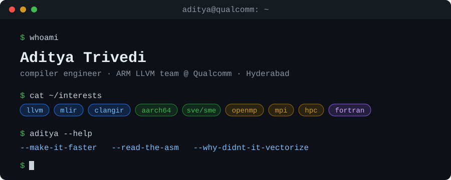

<div align="center">



<br>

[](https://www.linkedin.com/in/aditya-trivedi-a30b70259/)
[](https://portfolio-adit-six.vercel.app)
[](https://gsoc-blogs-5vgw.vercel.app)
[](https://github.com/adit4443ya/forge)

</div>

<br>

I write compiler code for ARM at Qualcomm. Most days that means staring at a loop, then at its assembly, until I know why they disagree about how fast it should be.

<br>

## What I work on

- **LLVM backends: AArch64.** I read IR and assembly until one of us blinks. NEON, SVE, SME.
- **MLIR and ClangIR.** I lower things one dialect at a time, upstream and in public, with reviewers.
- **OpenMP, MPI and GPU offload.** Teaching N cores to argue productively. In Google Summer of Code '25 I built OpenMP 6.0 infrastructure and GPU offloading for [LFortran](https://github.com/lfortran/lfortran).
- **HPC research.** Parallel graph algorithms, four publications. Graphs are matrices in denial, but BIG data indeed.
- **Fortran.** Older than my dependencies, faster than my opinions.

<br>

## `aditya.hpp`

```cpp
struct Aditya {
    std::string_view role  = "Compiler Engineer, ARM LLVM @ Qualcomm";
    std::string_view based = "Hyderabad, IN";
    std::array<std::string_view, 9> stack = {
        "C++", "LLVM", "MLIR", "ClangIR", "AArch64",
        "OpenMP", "MPI", "CUDA", "Fortran"};
    std::string_view gsoc  = "LFortran '25: OpenMP 6.0 + GPU offload";
    int  papers            = 4;      // parallel graph algorithms
    bool vectorized        = false;  // there's an if-condition in here somewhere
};
```

<sub>It compiles. I checked. Occupational hazard.</sub>

<br>

## Optimization remarks

```console
$ clang++ -O3 -Rpass-missed='.*' aditya.cpp
aditya.cpp:4:5:  remark: 'congratulate' not inlined: asked "what was the baseline?" first
aditya.cpp:9:3:  remark: loop not vectorized: there was an if-condition. there is always an if-condition
aditya.cpp:12:3: remark: loop not vectorized: -fsanitize=address was on (yes, I filed that issue)
aditya.cpp:15:1: remark: claim "it's memory-bound" not hoisted: no roofline drawn yet
aditya.cpp:18:7: remark: call to 'printf' not removed: still my favourite debugger
aditya.cpp:21:1: remark: Fortran kernel not replaced: still fast since 1957
aditya.cpp:23:1: warning: opinions on phase ordering have no users [-Wunused]
1 warning generated.
```

<br>

## Hot takes (mild, defensible)

- `-O3` is a flag, not a personality.
- A speedup without variance is a vibe.
- Read the assembly before you write the blog post.
- `restrict` fixes more loops than anyone wants to admit.
- Fortran isn't legacy. It's load-bearing.

<br>

## `git log --oneline` of a normal week

```text
4f1c2ab  fix: loop vectorizes now (it was the if-condition)
9e07d31  revert: it was not the if-condition
b2a6f88  fix: it was aliasing
c71d0e4  perf: 6% faster on the benchmark, 0% on everything else
a03e9f2  test: add the case reviewers will ask about anyway
e58b7c1  docs: explain why this pass runs before that one
```

<br>

## Things I've built

| Project | What it is |
|---|---|
| **[Forge](https://github.com/adit4443ya/forge)** | A practice gym for compiler, systems and low-latency engineers. 120 problems, 64 guided labs and a market-making game. Hints and solutions sit behind timers, and it remembers what you peeked at. |
| **[LFortran OpenMP](https://github.com/lfortran/lfortran)** | Google Summer of Code '25: OpenMP 6.0 infrastructure and GPU offloading. The write-up is on my [GSoC blog](https://gsoc-blogs-5vgw.vercel.app). |
| **[Portfolio](https://portfolio-adit-six.vercel.app)** | The longer version of this page. |

<br>

## Contribution graph

<picture>
  <source media="(prefers-color-scheme: dark)" srcset="https://raw.githubusercontent.com/adit4443ya/adit4443ya/output/github-contribution-grid-snake-dark.svg" />
  <source media="(prefers-color-scheme: light)" srcset="https://raw.githubusercontent.com/adit4443ya/adit4443ya/output/github-contribution-grid-snake.svg" />
  
</picture>

<br>

## Say hi

Talk to me about vectorizers, AArch64 codegen, OpenMP, or a benchmark you don't quite trust. [LinkedIn](https://www.linkedin.com/in/aditya-trivedi-a30b70259/) works best.

<br>

<div align="center">

*measure twice, optimize once.*

</div>
