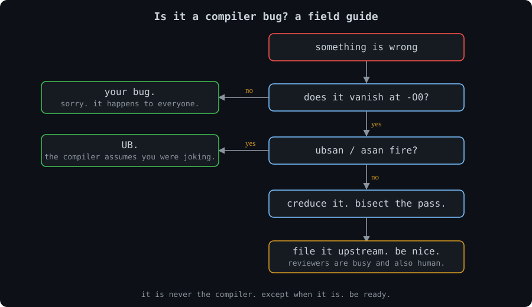

<div align="center">


</div>

<br>

I work on LLVM for ARM at Qualcomm. The job is convincing machines to run code faster, then convincing myself the speedup is real.

<br>

## What I'm into

| | |
|---|---|
| **LLVM and AArch64** | Reading IR and assembly until one of us blinks. NEON, SVE, SME. |
| **MLIR and ClangIR** | Lowering things one dialect at a time, upstream, in public, with reviewers. |
| **OpenMP, MPI, GPU offload** | Teaching N cores to argue productively. LFortran, Google Summer of Code '25. |
| **HPC research** | Parallel graph algorithms, five papers. Graphs are matrices in denial. |
| **Fortran** | Older than my dependencies, faster than my opinions. Respect. |

<br>

<div align="center">



</div>

<br>

## Known issues

```
$ man aditya | grep -A7 "KNOWN ISSUES"

  - asks "what was the baseline?" at parties
  - says "it's memory-bound" a lot. is right about as often as anyone
  - has opinions on phase ordering and nobody to share them with
  - will tell you your loop didn't vectorize because of the if-condition.
    his own didn't either. we're fine.
  - sanitizers can quietly stop the vectorizer. yes, really. there's an
    upstream issue. yes, he filed it. no, he is not proud.
  - considers printf() a debugger for people who trust themselves
  - believes Fortran was fast in 1957 and still is. cope.
```

<br>

<div align="center">



</div>

<br>

## Side quest: Forge

A practice gym for compiler, systems and low-latency people. The twist: hints, patterns and solutions sit behind timers, and it remembers what you peeked at. Think of it as a spotter for your brain. 120 problems, 64 guided labs, and a market-making game, because why not.

[](https://github.com/adit4443ya/forge)

<br>

## Find me

[](https://www.linkedin.com/in/aditya-trivedi-a30b70259/)
[](https://portfolio-adit-six.vercel.app)
[](https://gsoc-blogs-5vgw.vercel.app)

<br>

<div align="center">

*if your loop won't vectorize, I'll say it's the if-condition. I'm usually right. sometimes it's aliasing.*

</div>